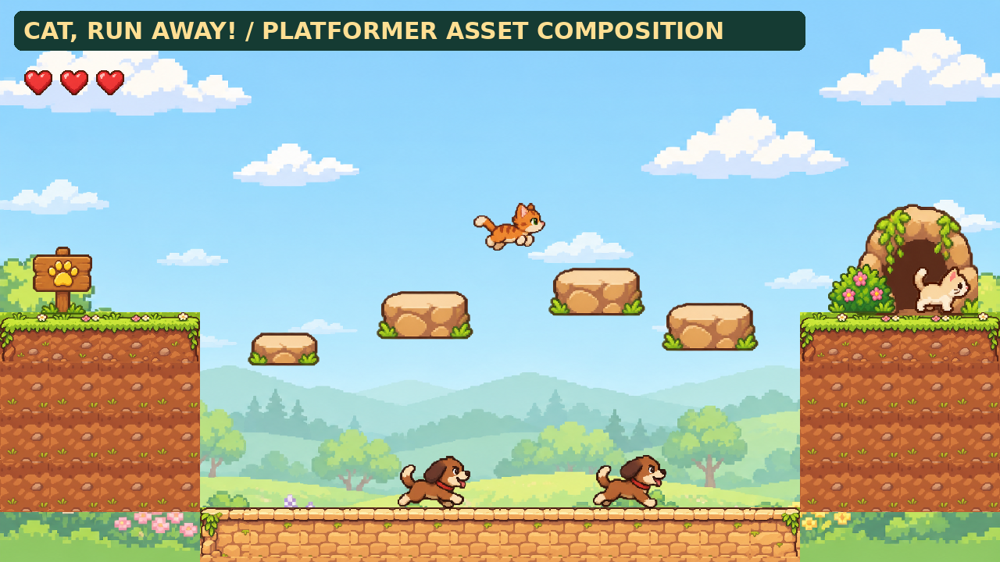
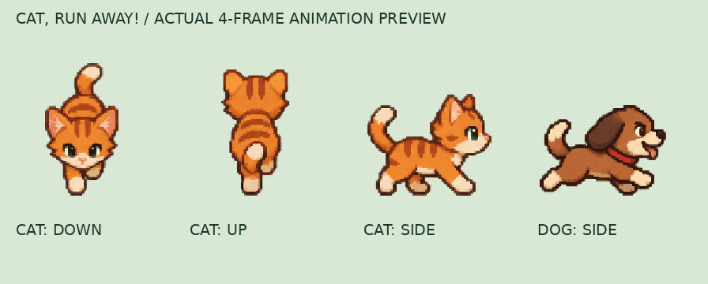

# Cat, Run Away!

Mała gra Lilli o kotku szukającym zaginionego rodzeństwa.
Wybrany kierunek: **labirynt z góry + parkour z boku**, kolorowa grafika pixel art.

Repozytorium zawiera obecnie **asset kit 0.2 i sceny podglądu w Godocie**.
To materiały do budowy gry, bez gotowej grywalnej pętli.

## Zawartość

- Bohater i pies: osobne klatki PNG, arkusze 128 px oraz SpriteFrames do ruchu w czterech kierunkach.
- Cztery pozy skoku bohatera; dodatkowe pozy psa.
- Mama kotka, rodzeństwo, klucz, drzwi, tunel, serduszka i przyciski.
- Elementy ogrodu i labiryntu.
- Rozszerzenie platformowe: 16 kafelków 64 px i atlas z kolizjami; 16 obiektów i jedno tło.
- 11 scen podstawowych platform StaticBody2D z osobną grafiką i kolizją.
- 6 krótkich oryginalnych syntetycznych dźwięków WAV.
- Łącznie 115 plików zasobów w manifeście; część to pojedyncze klatki i ich arkusze.

## Otwieranie

1. Pobierz repozytorium przez Code > Download ZIP lub sklonuj je.
2. Otwórz `project.godot` w Godot 4. Sprawdzono wersję **4.6.3**.
3. F5 uruchamia podgląd parkouru.
4. Przycisk **LABIRYNT / ANIMACJE** lub TAB przełącza podglądy.
5. W podglądzie animacji klawisze 1-6 odtwarzają dźwięki.

Nie jest to sterowalny poziom: nie ma jeszcze fizyki gracza, AI psa, wyszukiwania klucza
ani systemu ratowania rodzeństwa. Kompozycja nie służy do potwierdzania zasięgu skoku.

## Użycie assetów

Wczytaj `godot/hero_frames.tres` lub `godot/dog_frames.tres` w AnimatedSprite2D.
`walk_left` ma już odbite klatki. Ustaw filtrowanie Nearest.
Postacie mają klatki 128 x 128, oś x=64 i linię stóp y=122.
Dla węzła stojącego na ziemi użyj `offset = Vector2(0, -58)`.

Przypisz `godot/platformer_tileset.tres` do TileMapLayer lub przeciągaj sceny
z `godot/platforms/`. TileSet ma source_id=0, tile_size=64, physics layer=1.
Schody i dekoracje wymagają kolizji dobranych przy projektowaniu poziomu.
Szczegóły są w [instrukcji parkouru](docs/PLATFORMER_PL.md).

## Stan jakości

Import, odwołania, wymiary i przezroczystość sprawdzone. Weryfikacja objęła 16 kafelków
z kolizjami i 11 scen platform. Wybrane styki kafelków są sprawdzane pikselowo.
Atlas nie ma masek automatycznego łączenia; nie każda kombinacja krawędzi jest bezszwowa.
Animacje czteroklatkowe pozostają prototypowe i wymagają oceny podczas gry.
Tło jest pojedynczym skończonym obrazem, bez osobnych warstw paralaksy.
Nie przeprowadzono testu na telefonie ani przeglądu renderu GPU.

Szczegółowe wyniki: [QA](docs/QA.json).

## Pochodzenie

Grafika: wbudowane OpenAI ImageGen. Dokładne prompty i oryginały są w `source/`.
Dokładny identyfikator modelu obrazu nie jest ujawniony przez narzędzie.
Przygotowanie: Codex, rodzina GPT-6; dokładny wariant wykonawczy nie jest ujawniony.
Kod i oryginalne syntetyczne WAV: MIT, zobacz LICENSE_CODE_AUDIO.txt.
Deklaracja MIT nie obejmuje grafiki AI. Nie użyto pobranych assetów innych autorów.
